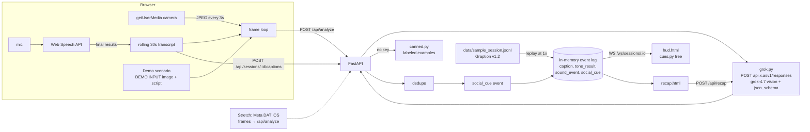

# Architecture

## Stack choice: FastAPI (Python) + plain HTML/JS pages (no build step)
- **Why web, not native iOS:** 90 minutes, 3-4 people, judges need a demo that can't fail on code signing or Bluetooth pairing. Chrome gives camera, mic and speech recognition (`getUserMedia`, `webkitSpeechRecognition`) for free.
- **Why FastAPI over Next.js:** Graption's server is already FastAPI + Pydantic + `uv` (`server/app/`), so this code can move into the Graption repo with no new stack. Python also makes JSON-Schema validation and the Grok call trivial. No bundler means fewer moving parts.
- **Why a backend at all:** the xAI key must stay server-side, plus dedupe, the event log, and an STT proxy.
- Alternative: if the team only knows JS, Next.js route handlers work the same way. Keep the API contract in API_SPEC.md identical.

## Components
| Component | Responsibility |
|---|---|
| `web/live.html` | Camera + mic capture, Web Speech transcript, 3 s frame loop, capture indicator, consent, cue cards, embedded HUD |
| `web/demo` (part of live.html) | Scenario buttons; sends DEMO INPUT image + scripted transcript |
| `web/hud.html` | Ray-Ban Display-shaped panel; subscribes to the event stream; renders cue trees |
| `web/recap.html` | Timeline, tone chart, sound and cue markers, "Catch me up" |
| `app/main.py` | FastAPI routes (API_SPEC.md), static files |
| `app/grok.py` | Only place that calls api.x.ai (vision cue, recap, optional STT) |
| `app/cues.py` | Event → HUD cue view-model → display tree (FlexBox/Text/Icon nodes) |
| `app/dedupe.py` | Suppress repeat cues (same `cue_type` + similar text within 20 s) |
| `app/store.py` | **In-memory** per-session event log (list of events). No disk writes for live data. |
| `app/canned.py` | Labeled canned outputs for demo mode without a key |
| `schemas/` | Graption `events.schema.json` (verbatim, v1.2) + `social_cue.schema.json` |
| `scripts/` | `validate.py`, `make_sample.py`, `replay.py` |

## Data flow


**Sequence for one live cue:** frame captured (t) → `/api/analyze` with `{session_id, t, transcript_window, image_b64}` → Grok returns SocialLens JSON → server wraps it as a `social_cue` event (adds `cue_id`, `t`, `model_version`) → dedupe sets `notified` → event appended to the store and broadcast on the WebSocket → HUD and cue list render it.

## Directory layout
```
graption-sociallens/
├── CLAUDE.md                 # = docs/AGENT_RULES.md
├── .cursor/rules/sociallens.mdc
├── .env.example              # XAI_API_KEY=, XAI_MODEL=grok-4.7
├── pyproject.toml            # fastapi, uvicorn[standard], httpx, jsonschema, pytest
├── app/
│   ├── main.py  grok.py  cues.py  dedupe.py  store.py  canned.py  prompts.py
├── web/
│   ├── live.html  hud.html  recap.html  app.css  common.js
│   └── demo/ dinner.jpg  sarcasm.jpg  wave.jpg      # labeled DEMO INPUT placeholders
├── schemas/
│   ├── events.schema.json    # verbatim from gt-big-data/graption (v1.2)
│   └── social_cue.schema.json
├── data/
│   ├── sample_session.jsonl  # Graption v1.2 events + social_cue, with _replay_t envelope
│   ├── scenarios.json        # 3 demo scenarios: image, transcript, canned output
│   └── speakers.json         # face_id -> display name/color (dashboard-only overlay)
├── scripts/ validate.py  make_sample.py  replay.py
├── tests/  test_schema.py  test_dedupe.py  test_cues.py  test_api.py
└── docs/   (this folder)
```

## Where it lives in the Graption repo later
- `schemas/events.schema.json`: add `SocialCue` to `oneOf` (bump to v1.3 per Graption's rule; regenerate Pydantic + Swift via the quicktype command in GRAPTION_CONTEXT.md §5).
- `server/app/`: `/api/analyze` and `/api/recap` routes next to the tone WebSocket (Platform team).
- `language/`: recap prompts and eval (Graption already plans "catch me up" summaries here).
- `apps/ios/Packages/GraptionUI`: HUD cue view, past-meetings dashboard. `GraptionNetwork`: an analyze client.
